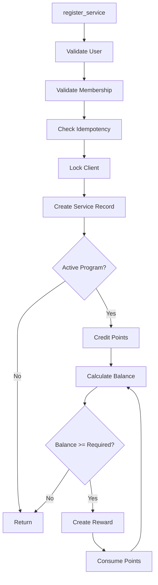

# Loyalty Flow and Atomic Operations

## register_service()

Responsibilities:
1. Validate auth.
2. Validate business membership.
3. Check idempotency.
4. Lock client.
5. Validate client/service/business.
6. Create service record.
7. Find active loyalty program.
8. Credit service points.
9. Calculate balance.
10. Issue rewards when threshold is reached.
11. Consume points for issued rewards.
12. Return complete result.

## redeem_reward()

The service and redemption happen atomically.

Responsibilities:
1. Validate auth/membership.
2. Check idempotency.
3. Lock client.
4. Lock reward.
5. Validate reward availability/expiry.
6. Calculate discount.
7. Create service record.
8. Create redemption.
9. Mark reward redeemed.
10. Credit points for the new service.
11. Issue any new rewards.
12. Return complete result.

Supported reward types:
- percentage
- fixed_amount
- free_service
- custom (not auto-redeemable in MVP)
